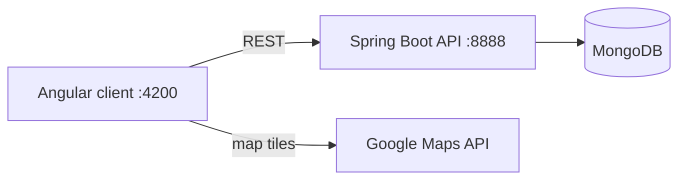

# Nest: Property Rental Platform

A full-stack rental platform with an Angular front end and a Spring Boot REST API backed by MongoDB. Landlords list properties, and tenants browse them, book viewing appointments, leave reviews and message the landlord.

**Live demo:** https://nest-property-rental-platform.vercel.app (front end only, sample listings, see [Hosted demo](#hosted-demo)). An earlier build is also on Netlify: https://mynest.netlify.app


**Status:** finished prototype (2025). No automated tests.

## Features

- Sign up and log in with JWT-based authentication
- Property listings with search, a details page and a map view
- Landlords can add properties with rental details and a photo gallery
- Viewing appointments, with notifications for both sides
- Reviews on properties
- Chat between users, with a conversations list
- Profile editing

## Tech stack

| Layer | Tools |
|---|---|
| Client | Angular 16, Angular Material, RxJS, TypeScript, SCSS |
| Server | Java 17, Spring Boot 3.1, Spring Data MongoDB, JJWT, Lombok |
| Database | MongoDB |
| Maps | Google Maps JavaScript API |

## Architecture



The server follows a controller, service, repository layering. The controllers expose `/user`, `/property` and `/chat` routes (for example `/user/login`, `/property/get/all`, `/property/appointment/add`, `/chat/add`).

## Project structure

```
Client/   Angular app (components under src/shared/component)
Server/   Spring Boot app (controller, service, repository, model, jwt)
```

## Hosted demo

The Vercel deployment serves the Angular client only. The Spring Boot API and MongoDB are not hosted, so when the app is opened on any host other than localhost it runs in demo mode: a browser-side interceptor (`Client/src/shared/demo`) returns a few invented listings for the property list, and every other API call fails. You can browse listings, search by city and locality and open a details page. Login, signup, booking, reviews, chat and adding properties need the real server. The map needs a Google Maps key, which is not set in the hosted build. The sample images are placeholders.

## Run locally

Requirements: Java 17, Node.js 18 or later, a running MongoDB, and a Google Maps API key.

1. Configure the server:

   ```bash
   cd Server/src/main/resources
   cp application.properties.example application.properties   # set your MongoDB URI
   ```

2. Start the API:

   ```bash
   cd Server
   ./mvnw spring-boot:run
   ```

3. Add your Google Maps key in `Client/src/index.html` and `Client/src/shared/component/details/details.component.ts` (replace `YOUR_GOOGLE_MAPS_API_KEY`).

4. Start the client:

   ```bash
   cd Client
   npm install
   npm start
   ```

The client calls the API at `http://localhost:8888` (set in `Client/src/shared/config.ts`). These steps are written from the code and have not been re-verified on a clean machine.

## Limitations

- The JWT signing key is generated on each server start, so tokens are invalid after a restart.
- API URLs and the Maps key are set in source files rather than environment configuration.
- No tests beyond the default Spring context test.

## License

MIT, see [LICENSE](LICENSE).

## Contact

Anubhav Gupta, [LinkedIn](https://www.linkedin.com/in/anubhavgupta8)
